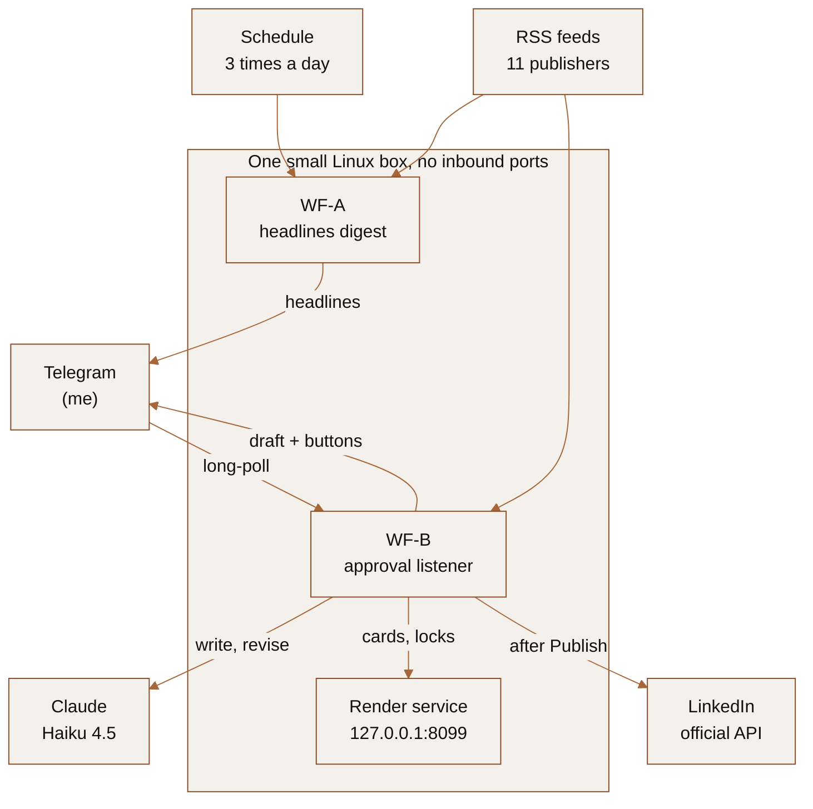

# LinkedIn daily agent

A self-hosted agent that finds tech and AI news, drafts a LinkedIn post in my voice, designs the image, and waits in Telegram for my approval before anything is published.

## Why I built it

I post about cloud and AI on LinkedIn. The opinion is the quick part. The slow part is finding a story worth posting, pulling the real numbers out of the article, and making an image that doesn't look like a stock template. I wanted help with that part and nothing else, so the agent drafts and I decide. Nothing reaches LinkedIn until I tap Publish in Telegram.

It posts only through LinkedIn's official API, only with my approval, and only to my own profile. It does not scrape LinkedIn: it never reads profiles, feeds or other people's posts, and it won't open LinkedIn links pasted into the chat.

## What it does

- At 07:00, 12:00 and 18:00 it sends me a page of 10 recent tech and AI headlines from 11 publisher RSS feeds, with at most 3 stock-market stories per page and no product reviews. I reply with the link I want a post about, or send `/new` and let it pick.
- For the story I pick, it fetches the full article, and Claude Haiku 4.5 writes a 90 to 140 word post using the article's own figures: airy spacing, a short list of hard numbers, one soft take, no em dashes, money as `$` and percentages as `%`, and 5 to 8 hashtags. If it can't verify something it says so in a note instead of inventing it.
- Each draft gets a 1080x1080 card rendered by headless Chromium. One style puts the headline in a white box with a red border over the article's photo. The other is a dark post layout with my name. If the article photo won't load, it falls back to Wikipedia or Wikimedia Commons.
- The preview, post text and source link arrive in Telegram with buttons to like or skip the draft, swap to a different story, switch between the two card styles, use a clip from the story's video, use a screenshot of the article, or use one real photo or a small gallery instead of the card. After I like it, I choose Publish now, Save as draft, or Discard.
- Other inputs: paste an article link, `/new <topic>`, plain text to revise the current draft, a photo to use as the card background, a photo with a caption for a standalone title card, or a video to watermark and post as native LinkedIn video. An x.com link gets a card that shows that real post, with my take as the text.
- Publishing goes only through LinkedIn's official API: images through n8n's LinkedIn node, video and drafts through the Posts API. Save as draft puts the text in my LinkedIn composer, so I can tag people and schedule it myself.

## How it fits together



Both workflows run in n8n. The render service is a small Python `http.server` bound to localhost. It does what n8n can't do on its own: Chromium screenshots, ffmpeg watermarks and clips, plus the lock and idempotency state described below. [ARCHITECTURE.md](./ARCHITECTURE.md) covers every branch, endpoint and gotcha.

## Design decisions worth reading

### Approvals over an outbound-only long-poll

Telegram webhooks need an HTTPS endpoint the internet can reach. I didn't want to open a port on my network for a posting bot, so WF-B is one long-running n8n execution that calls `getUpdates` with a 50 second timeout, handles one event, and loops. A schedule tick every 15 seconds starts a listener if none is running, and after 15 minutes the running one hands over to a fresh one. Everything is outbound, so approvals work from my phone on cellular and nothing on the box is exposed.

The trade-off is that the listener is single-threaded. When it's idle, a button answers in a second or two. While it's working on a slow request (a news draft takes about 11 seconds), other taps wait their turn, so every slow request posts a short status message to show it's working.

### The `/claim` single-listener lock

Early on, the agent posted the same draft to LinkedIn twice. n8n's workflow static data only persists when an execution ends, so two overlapping listener executions both saw the same Telegram callback. Now the listener has to hold a lock in the render service before it polls: `POST /claim` with its execution id and a 65 second TTL. It renews the lock on every loop and releases it at the 15 minute cap. A second execution that can't get the lock just exits.

### The `/posted` publish-once gate

Telegram delivers updates at least once, and a slow branch can outlive the 65 second lock, which would let a second listener start and see the same tap. So before anything with side effects (Publish, Different news), WF-B calls `POST /posted` with the draft id. Only the first call returns `first: true`, and every repeat stops right there. The lock makes duplicates rare. The gate makes a duplicate post impossible.

### Workflows generated from `build_wf.py`, not edited in the canvas

The listener workflow has about 210 nodes. Editing that in the n8n canvas was slow and impossible to review. `build_wf.py` generates both workflow JSON files from Python: node helpers, one shared JavaScript card renderer, and a single connection map. The result diffs cleanly in git, and asserts catch mistakes at build time (for example, the voice prompt is embedded in a single-quoted n8n expression, so it can't contain an apostrophe). `import_workflows.py` pushes the JSON through n8n's REST API and stops the running listener first. The trade-off: any change made in the n8n UI is overwritten on the next import, so I only change the generator.

### Honesty rules in the output

A few rules come from drafts that looked fine but weren't true. A quote only appears on a card if it's in the article word for word and the speaker is named next to it. The post-style card never shows invented like or view counts. A card is never drawn as if someone from the story posted it: their real words can appear, but only as an attributed quote in my post.

### Cost

Claude Haiku 4.5 costs $1 per million input tokens and $5 per million output tokens. A news draft is two calls. The story picker reads about 24 RSS items (roughly 23,000 input tokens), then the writer reads a 10,000 character system prompt plus up to 7,000 characters of article (roughly 5,000 tokens) and writes about 500. That comes to about 3 cents. A draft from a pasted link skips the picker and costs under a cent, and so does a revision. The scheduled headlines digest makes no model call at all. Telegram's Bot API and posting through LinkedIn's API are free. The whole thing runs on one Debian box with about 1.5 GB of RAM.

## Setup

You need a Linux host for n8n and the render service, a Telegram bot, a LinkedIn developer app, and an Anthropic API key. All secrets and instance IDs live in `config.env`, which is gitignored.

Who the posts are written as comes from `DISPLAY_NAME` and `AUTHOR_BIO` in `config.env`. The rest of the voice prompt (`SYSTEM` in `build_wf.py`) encodes my style and topics, so adjust it for yours before using this.

### 1. Host and n8n

Use a Debian or Ubuntu VM or container with about 1.5 GB of RAM. Install n8n natively with SQLite (Docker and Postgres aren't needed), plus Node.js in whatever version your n8n release requires:

```bash
apt update && apt install -y python3 python3-venv chromium ffmpeg fontconfig curl fonts-inter fonts-noto-color-emoji
npm install -g n8n
```

Run n8n as a systemd service under its own user (for example `n8n`, data in `/opt/n8n/.n8n`) with `GENERIC_TIMEZONE` set to your timezone. Set `N8N_SECURE_COOKIE=false` only if you log in over plain HTTP on your LAN. Back up `N8N_ENCRYPTION_KEY` from `/opt/n8n/.n8n/config`: without it, saved credentials can't be decrypted after a restore.

### 2. Render service

Install the Sora font to `/usr/share/fonts/truetype/sora/Sora.ttf` and run `fc-cache -f`.

The video clip button is optional. It needs yt-dlp in a venv at `/opt/render/venv` and Deno at `/usr/local/bin/deno`, which yt-dlp uses for YouTube. Install Deno from its official instructions. The paths can be changed with the `YTDLP`, `DENO` and `DENO_DIR` environment variables.

```bash
python3 -m venv /opt/render/venv && /opt/render/venv/bin/pip install yt-dlp
```

Then install the service on the n8n host as root. The run user must match your n8n user, and the third argument is your LinkedIn handle (the slug in `linkedin.com/in/<slug>`):

```bash
sudo ./deploy_render_service.sh render_service.py n8n your-handle
# expect "active" and "ok" from /health
```

### 3. Telegram bot

Create a bot with @BotFather and copy the token. Send the bot one message, then get your chat id from @userinfobot or from `https://api.telegram.org/bot<TOKEN>/getUpdates`.

### 4. n8n credentials

Create these in the n8n UI and copy each credential's id from its URL:

- LinkedIn OAuth2, with scopes `w_member_social, profile, email, openid` (legacy off). Register `https://<your-n8n-domain>/rest/oauth2-credential/callback` as the redirect URL in your LinkedIn app. After connecting, call `GET https://api.linkedin.com/v2/userinfo`; the `sub` field is your person URN.
- Telegram API, with the bot token.
- Anthropic, as Header Auth: name `x-api-key`, value your API key.

LinkedIn requires an HTTPS redirect URL, but only the OAuth connect step uses it. Any reverse proxy with a real certificate works. I use Caddy with a Let's Encrypt certificate issued over DNS-01, so the hostname only resolves inside my LAN and nothing has to be reachable from the internet.

### 5. Configure

```bash
cp config.example.env config.env
chmod 600 config.env
# fill in the three credential ids, CHAT_ID, PERSON_URN, TG_TOKEN, LINKEDIN_HANDLE,
# DISPLAY_NAME, AUTHOR_BIO, TIMEZONE, CONTACT_EMAIL and N8N_URL / N8N_EMAIL / N8N_PASSWORD.
# Leave WF_A_ID and WF_B_ID blank for the first import.
```

### 6. Generate and import the workflows

```bash
python3 build_wf.py wf_a.json wf_b.json
python3 import_workflows.py      # creates both workflows and prints their ids
# paste the printed WF_A_ID and WF_B_ID into config.env
```

The generated JSON embeds the bot token and credential ids, which is why `wf_*.json` is gitignored.

### 7. Telegram guide and commands

```bash
python3 setup_telegram.py        # sends and pins the guide, sets /new /headlines /help
# later: python3 setup_telegram.py <message_id> edits the pinned guide in place
```

## Updating later

```bash
# edit build_wf.py, then:
python3 build_wf.py wf_a.json wf_b.json
python3 import_workflows.py      # with ids set: stops the listener, patches, reactivates
ssh <n8n-host> "systemctl restart linkedin-render"   # clears the /claim lock
```

If you change `render_service.py`, copy it to the host and run `deploy_render_service.sh` again.

A few things worth knowing:

- A WF-B change doesn't go live until the old listener stops. `import_workflows.py` stops it, and restarting the render service clears the lock, so a new listener starts within 15 seconds.
- Telegram bots can only download files up to about 20 MB, so keep videos short.
- Tagging people isn't automated, because LinkedIn mentions need member or company URNs that can't be looked up by name. Save as draft is for that: add the tags in LinkedIn's composer.

## Files

| File | Purpose |
|------|---------|
| `build_wf.py` | Generates `wf_a.json` and `wf_b.json`. The source of truth: edit this, not the JSON. |
| `render_service.py` | Localhost render, lock and idempotency service. |
| `import_workflows.py` | Creates or updates the two workflows through n8n's REST API. |
| `deploy_render_service.sh` | Installs `render_service.py` as the `linkedin-render` systemd unit. |
| `setup_telegram.py` | Sends or edits the pinned Telegram guide and sets the bot's command menu. |
| `config.example.env` | Template for every secret and id. Copy it to `config.env`. |
| `ARCHITECTURE.md` | Full design notes: every branch, endpoint and lesson learned. |

## Licence

MIT. See [LICENSE](./LICENSE).
